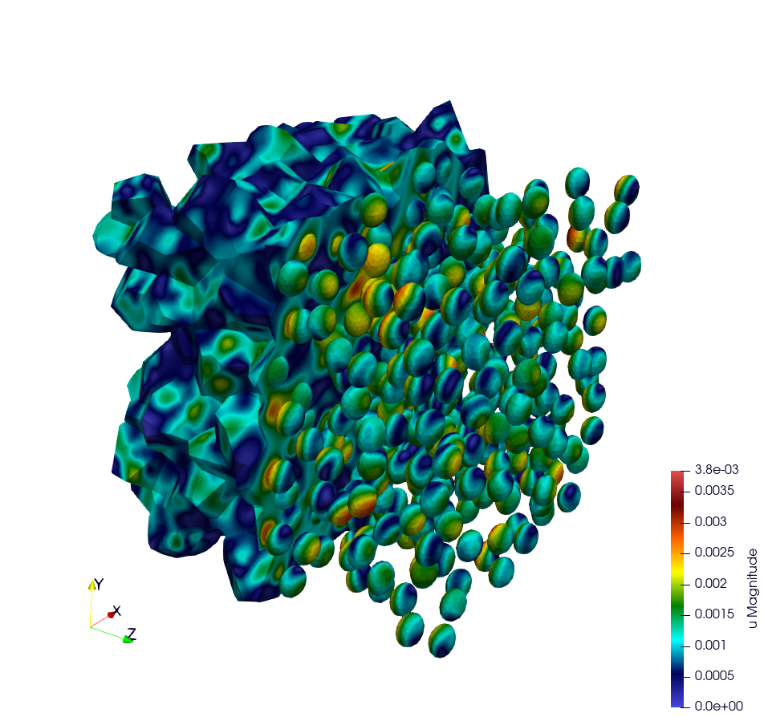

# Representative Volume Element of Combustible Mixed Oxides for Nuclear Applications

This simulation represents an RVE of MOx (Mixed Oxide) material under uniform macroscopic
deformation. Its results are compared to the ones obtained by (Fauque et al., 2021; Masson et al., 2020)
who used an FFT method.

## Problem solved

```text
    Problem : RVE MOx 2 phases with elasto-viscoplastic behavior laws

    Parameters :

    start time = 0
    end time = 5s
    number of time step = 40

    Imposed strain tensor :
            [ -a/2 ,   0  ,  0 ]
    eps  =  [   0  , -a/2 ,  0 ] * t
            [   0  ,   0  ,  a ]
    with a = 0.012 s^-1

    Solver : HypreGMRES (default, option -ls), or a direct solver
             (MUMPSSolver, or CuDSSSolver on a CUDA GPU)
    Preconditioner : HypreBoomerAMG (with HypreGMRES)

    Moduli and Norton behavior law parameters :
    [ parameters       , matrix   , inclusions ]
    [ Young Modulus    , 8.182e9  , 2*8.182e9  ];
    [ Poisson Ratio    , 0.364    , 0.364      ];
    [ Stress Threshold , 100.0e6  , 100.0e12   ];
    [ Norton Exponent  , 3.333333 , 3.333333   ];
    [ Temperature      , 293.15   , 293.15     ];

    Element :
    - Family H1
    - Order 2
```

The matrix is the material 1 of the meshes and the inclusions the material 2. The stress
threshold of the inclusions is high enough for them to remain elastic.



## How to run the simulation "RVE MOX"

## Build the mesh

Two meshes are provided in the directory `mesh`:

- `OneSphere.msh`, the default mesh, with one spherical inclusion (17 % of the volume) meshed
  by quadratic tetrahedra;
- `inclusion.msh`, with one inclusion (11 % of the volume) meshed by linear tetrahedra.

The meshes are generated with MEROPE and GMSH through the following steps:

- First step, use MEROPE to generate a `.geo` file using the RSA algorithm. Scripts are in directory `script_merope`. Command line:

```bash
# generate .geo file with MEROPE
python3 script_17percent_minimal.py
```

- Second step, use GMSH to mesh the geometry. Files `.geo` are in the directory `file_geo`. Command line:

```bash
# generate the .msh file with GMSH
gmsh -3 OneSphere.geo
```

## Run the simulation

### Run a minimal version of the simulation

In order to run the simulation in sequential computing mode, use the command line, in the build
directory:

```bash
# run the simulation by specifying the mesh with --mesh option
./mox2 --mesh mesh/OneSphere.msh
```

### Available options

To customize the simulation, several options are available, as detailed below.

Command line | Description
---|---
--mesh or -m | mesh file (default = mesh/OneSphere.msh)
--library or -l | behaviour library (default = the library built with the example, by the `generic` interface of MFront for the CPU or by the `generic-parallel` interface for the GPU, as `--execution` places the behaviours)
--refinement or -r | refinement level of the mesh (default = 0)
--nbsteps or -ns | number of time steps, the end time being 5 s (default = 40)
--order or -o | finite element order (polynomial degree) (default = 2)
--verbosity-level or -v | verbosity level of the linear solver (default = 0)
--linear-solver or -ls | linear solver: `HypreGMRES` preconditioned by `HypreBoomerAMG` (default), or a direct solver of mfem-mgis, `MUMPSSolver` or `CuDSSSolver` (on a CUDA GPU only); an invalid value is refused
--matrix-symmetry or -ms | symmetry of the matrices given to the direct solver: `Unsymmetric` (default), `SymmetricIndefinite` or `SymmetricPositiveDefinite` (the lower triangle is given without checking the symmetry); an invalid value is refused
--reuse-analysis or -mra, --no-reuse-analysis or -no-mra | reuse the analysis of the direct solver (ordering and symbolic factorization) for the matrices of the same pattern, as the tangent operators of the successive Newton iterations (default = no; requires a mfem-mgis providing the parameter `ReuseAnalysis`). The options `-ms` and `-mra` are ignored, with a warning, without a direct solver
--execution or -x | option of mfem-mgis: `cpu`, `gpu` (all the computations on the GPU) or `mixed`, each phase being placed by `--finite-elements`, `--behaviours`, `--linear-solver-device` and `--post-processings` (`cpu` or `gpu`)
--device, --hypre-on-host | options of mfem-mgis for the experts: device of MFEM (for instance `cuda`), computations of hypre on the host when the device is a GPU
--post-processing or -pp, --no-post-processing or -no-pp | export or not the results to Paraview (default = export)
--reference-file or -rf | file of reference values of the mean stresses in each material, no comparison if empty (default)
--use-petsc and --petsc-configuration-file | use PETSc with the given configuration file, for example `petscrc` (requires MFEM built with PETSc)

Example of customized simulation:

```bash
# run the simulation in sequential computing mode with various options
./mox2 -r 2 -o 3 --mesh mesh/OneSphere.msh
```

The example builds the behaviour for the CPU and, if MFEM uses a GPU, for
the GPU: `--execution gpu` runs all the computations on the GPU, with the
behaviour generated for the GPU:

```bash
mpirun -n 1 ./mox2 --no-post-processing --execution gpu
```

The tangent operators of this example are symmetric and positive definite.
With the default mesh, 40 steps, the behaviour integrated by batches and
the gradients, the inner forces and the tangent operator computed by
kernels, the simulation takes 6.1 s on 2 processes with `HypreGMRES` and
5.4 s with `-ls MUMPSSolver -ms SymmetricPositiveDefinite -mra`. On one
GPU, it takes 4.3 to 4.6 s with `HypreGMRES` (hypre on the host) and 2.0
to 2.1 s with the direct solver of the GPU, cuDSS, the matrices being
assembled by hypre on the host. This last placement (solver on the GPU,
hypre on the host) is only given by the options of mfem-mgis for the
experts, with the library for the GPU built by the example:

```bash
MFEM_MGIS_BEHAVIOUR_INTEGRATION=Batch \
MFEM_MGIS_GRADIENTS_COMPUTATION=Kernels \
MFEM_MGIS_INNER_FORCES_COMPUTATION=Kernels \
MFEM_MGIS_TANGENT_OPERATOR_COMPUTATION=Kernels \
mpirun -n 1 ./mox2 --no-post-processing --device cuda --hypre-on-host \
  -l BehavioursEx7/gpu/libBehaviour.so \
  -ls CuDSSSolver -ms SymmetricPositiveDefinite -mra
```

### Parallel computing mode

The simulation can be run in parallel computing mode by using the command:

```bash
# generate the mesh with 634 spheres, which is not provided
gmsh -3 file_geo/634Spheres.geo
# run the simulation by specifying the mesh with --mesh option
mpirun -n 12 ./mox2 --mesh file_geo/634Spheres.msh
```

Simulation can be run on supercomputers. The command depends on the server manager. For example, on Topaze, a CCRT-hosted supercomputer co-designed by Atos and CEA, the commands are :

```bash
ccc_mprun -n 8 -c 1 -p milan ./mox2 -r 0 -o 3 --mesh mesh/OneSphere.msh
ccc_mprun -n 2048 -c 1 -p milan ./mox2 -r 2 -o 1 --mesh file_geo/634Spheres.msh
```

### Test

The test runs the default simulation (`mesh/OneSphere.msh`, order 2) and compares the mean stresses
in each material to the reference values of `OneSphere-avgStress-40steps.ref`. In the restricted
test mode, used by default in the debug and coverage builds, it uses 5 time steps instead of 40 and
compares the mean stresses to `OneSphere-avgStress-5steps.ref`. With 5 time steps, the average stress SZZ differs by
less than 9 % from the one computed with 40 time steps.

## Post-processing of simulation data

The simulation results are compared to the ones of (Fauque et al., 2021; Masson et al., 2020).
To this end, the average stresses in the z-axis direction (SZZ) will be analyzed. The reference values, obtained by (Fauque et al., 2021; Masson et al., 2020), can be found in the directory `results`, file res-fft.txt (Average stress versus time).

### Extract simulation data from MMM

The avgStress post-processing file generated by MMM contains average stress values as a function of time, by material phase. MMM simulation data are available in the directory `results`:

- `res-mfem-mgis.txt`: average stress SZZ over the RVE of `OneSphere.msh` at order 3, obtained with the awk command below;
- `res-mfem-mgis-634spheres-o2.txt`: avgStress file of the RVE with 634 spheres at order 2.

For example, the average stress SZZ over the RVE (composed of 83% matrix and 17% inclusion) can be calculated with the awk command under unix:

```bash
awk '{if(NR>13) print $1 " " 0.83*$4+0.17*$10}' avgStress > res-mfem-mgis.txt
```

The average stress SZZ at the end of the simulation (t = 5 s) is:

Simulation | SZZ (MPa)
---|---
FFT (`res-fft.txt`) | 93.05
`OneSphere.msh`, order 3 (`res-mfem-mgis.txt`) | 94.63
`OneSphere.msh`, order 2 (default) | 99.87
`OneSphere.msh`, order 1 | 140.0
634 spheres, order 2 (`res-mfem-mgis-634spheres-o2.txt`) | 101.6

At order 1, the average stress is overestimated once the matrix flows, which is consistent with
the volumetric locking of linear tetrahedra, since the viscoplastic flow is isochoric.

### Display results with gnuplot

```bash
gnuplot> plot "res-fft.txt" u 1:10 w l title "fft"
gnuplot> replot "res-mfem-mgis.txt" u 1:2 w l title "mfem-mgis"
```
