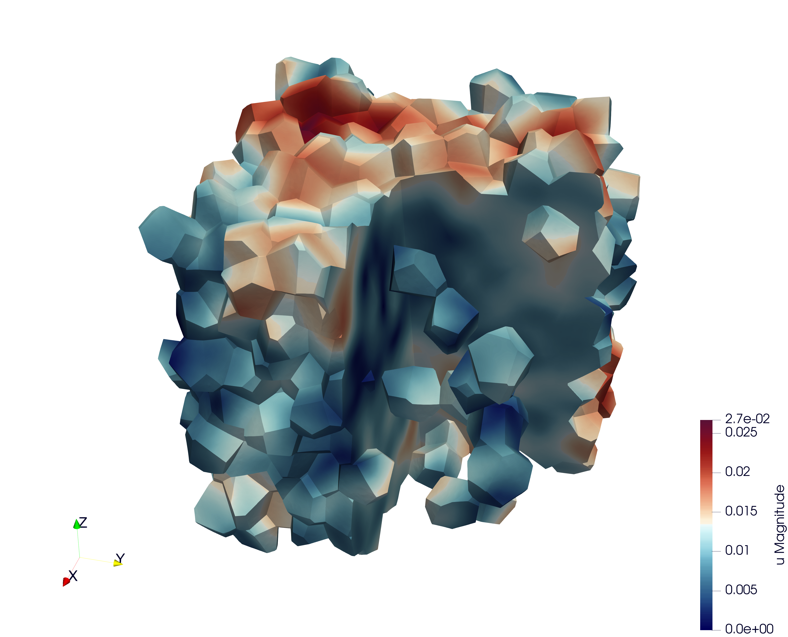
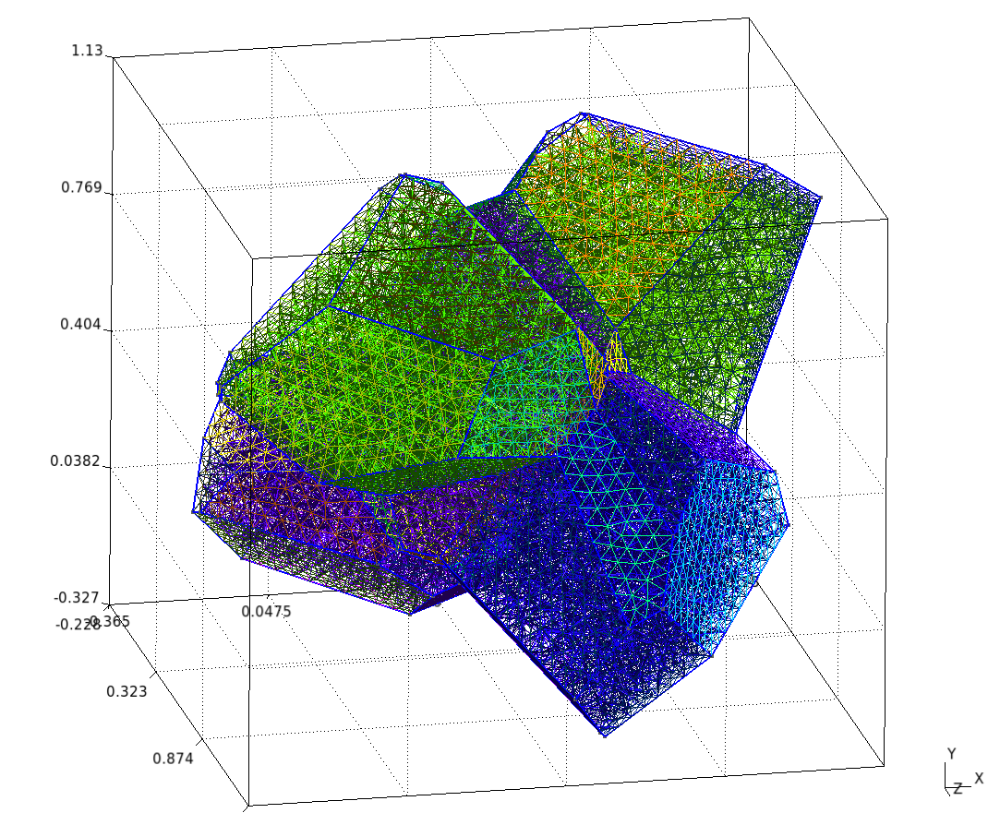
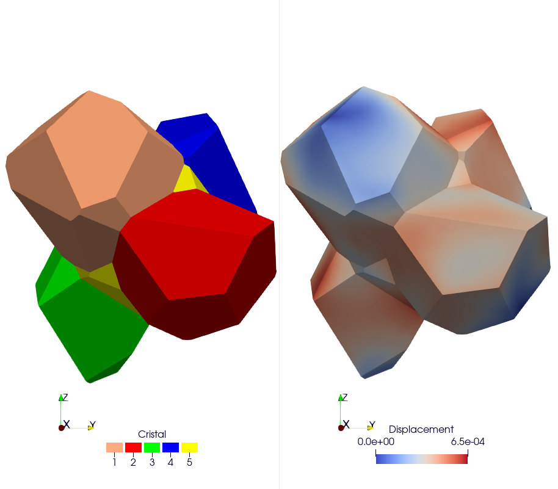
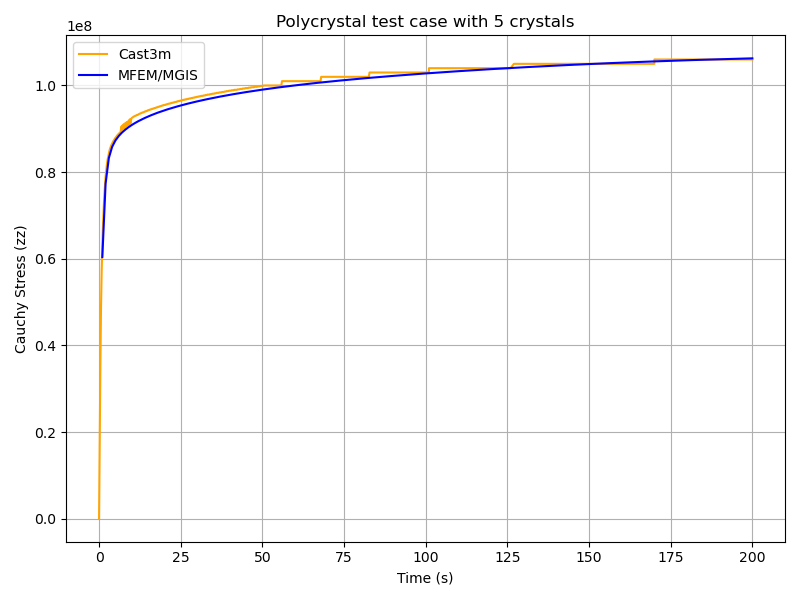

Polycrystal
===========

.. contents::

Repository: ``https://github.com/rprat-pro/mm-opera-hpc/tree/main/polycrystal``

Problem definition
------------------

This test case illustrates the simulation of a **Representative Volume Element (RVE)** of a polycrystal made of uranium dioxide (UO₂). The objective is to study the mechanical response of the material under uniaxial loading. This example also implements a fixed-point algorithm that enables the simulation of a uniaxial compression/tensile test with periodic boundary conditions.

**Boundary conditions**

* Periodic boundary conditions are applied on the RVE faces.
* The loading is imposed in one direction (axial component :math:`F_{zz}` of the macroscopic deformation gradient). The off-diagonal components of the macroscopic deformation gradient are set to zero.
* The macroscopic unknowns :math:`F_{xx}` and :math:`F_{yy}` are determined via a fixed-point algorithm imposing :math:`S_{xx}=S_{yy}=0` (macroscopic components of the Cauchy stress tensor).
* The main verification result is the evolution of :math:`S_{zz}` (Cauchy) as a function of time.

Numerical and physical parameters

* **Finite element order:** 1 (linear interpolation)
* **Finite element space:** :math:`H^1`
* **Simulation duration:** 200 s
* **Number of time steps:** 200 by default (option ``--nstep``)

**Constitutive law (crystal)**

The ``UO₂`` crystal plasticity law used in this example is described in reference [#portelette2018]_, and the corresponding MFront file is available on the MMM GitHub repository. In the case of uranium dioxide, the crystal symmetry is cubic, and the corresponding orthotropic elastic properties used in the crystal plasticity law are:

* Young's modulus = 222.e9 Pa
* Poisson's ratio = 0.27
* Shear modulus = 54.e9 Pa

The orthotropic basis of each grain is provided as input material data, precomputed from the grain Euler angles. The fixed-point algorithm uses the homogenized elastic properties of the polycrystal to predict the displacement gradient required to converge toward a uniaxial tensile test. These macroscopic properties are derived from the single-crystal elastic constants given above, taking the mean values of the Voigt and Reuss bounds for an isotropic polycrystal (see `MacroscropicElasticMaterialProperties.cxx` in the repository).

Mesh generation
---------------

This section explains how to generate a sample mesh using the **Merope** toolkit [#josien2024]_.

Before running the script, ensure that the environment variable `MEROPE_DIR` is properly loaded:

.. code-block:: bash

   source ${MEROPE_DIR}/Env_Merope.sh

Then, generate the mesh in two steps:

.. code-block:: bash

   source ${MEROPE_DIR}/Env_Merope.sh
   python3 mesh/5crystals.py # generates 5crystals.geo
   gmsh -3 5crystals.geo     # generates 5crystals.msh

You will obtain a 3D mesh (`5crystals.msh`) of a polycrystalline sample composed of 5 grains.

Mesh generation options
~~~~~~~~~~~~~~~~~~~~~~~

The following parameters are set in the ``mesh/5crystals.py`` script:

.. code-block:: python

    L = [1, 1, 1]        # Dimensions of the RVE box
    nbSpheres = 5        # Number of grains (polycrystal composed of 5 crystals)
    distMin = 0.4        # Minimum distance between sphere centers
    randomSeed = 0       # Random seed for reproducibility
    MeshOrder = 1        # Polynomial order of elements
    MeshSize = 0.05      # Target mesh size

The resulting polycrystal is composed of 5 grains.

Mesh Polycrystal composed of 5 crystals
~~~~~~~~~~~~~~~~~~~~~~~~~~~~~~~~~~~~~~~

Simulation options
------------------

The main executable for this test case is **uniaxial-polycrystal**. Its command-line options are:

.. code-block:: bash

   ./uniaxial-polycrystal --help

Main options
~~~~~~~~~~~~

.. list-table:: Executable options
    :header-rows: 1

    * - Option
      - Type
      - Default
      - Description
    * - ``-h, --help``
      - flag
      - off
      - Print the help message and exit.
    * - ``-m <string>, --mesh <string>``
      - string
      - ``mesh/5crystals.msh``
      - Mesh file to use.
    * - ``-mm <string>, --mesh_mode <string>``
      - string
      - ``FromScratch``
      - Mesh read mode: ``FromScratch``, or ``Restart`` for a mesh already
        split in parts, one per process.
    * - ``-f <string>, --vect <string>``
      - string
      - ``mesh/vectors_5crystals.txt``
      - Vector file to use.
    * - ``-l <string>, --library <string>``
      - string
      - built with the case
      - Material library. By default, the library built with the case, for
        the CPU or the GPU, as ``--execution`` places the behaviours.
    * - ``-b <string>, --behaviour <string>``
      - string
      - ``Mono_UO2_Cosh_Jaco3``
      - Mechanical behaviour.
    * - ``-o <int>, --order <int>``
      - int
      - ``1``
      - Finite element order (polynomial degree).
    * - ``-r <int>, --refinement <int>``
      - int
      - ``0``
      - Mesh refinement level.
    * - ``-v <int>, --verbosity-level <int>``
      - int
      - ``0``
      - Output verbosity level.
    * - ``-d <double>, --duration <double>``
      - double
      - ``200``
      - Simulation duration.
    * - ``-n <int>, --nstep <int>``
      - int
      - ``200``
      - Number of time steps.
    * - ``-dg, --displacement-gradient``, ``-no-dg, --no-displacement-gradient``
      - bool
      - ``false``
      - Give the displacement gradient :math:`H = F - I` instead of the
        deformation gradient to the behaviour (parameter
        ``DisplacementGradient`` of mfem-mgis). In single precision, the
        macroscopic loading, kept as a displacement gradient, keeps its
        precision. The behaviour, written with the deformation gradient,
        receives :math:`F = I + H`.
    * - ``--linear-solver <string>``
      - string
      - ``HyprePCG``
      - Linear solver of the Newton method: a Krylov solver of hypre
        (``HyprePCG``, ``HypreGMRES`` or ``HypreFGMRES``, preconditioned by
        ``--linear-solver-preconditioner``), or a direct solver of mfem-mgis,
        ``MUMPSSolver`` or ``CuDSSSolver`` (on a CUDA GPU only). Ignored by
        ``NewtonK0``.
    * - ``--linear-solver-preconditioner <string>``
      - string
      - ``HypreBoomerAMG``
      - Preconditioner for the linear solver. Use ``none`` to disable.
    * - ``--reuse-analysis``, ``--no-reuse-analysis``
      - bool
      - ``false``
      - Reuse the analysis of the direct solver for the matrices of the same
        pattern (parameter ``ReuseAnalysis`` of mfem-mgis). Ignored, with a
        warning, without a direct solver, with ``NewtonK0`` or with PETSc.
    * - ``--non-linear-solver <string>``
      - string
      - ``Newton``
      - Non linear solver: ``Newton`` or ``NewtonK0`` (tangent systems solved
        by a conjugate gradient preconditioned by the elastic operator).
    * - ``--adaptive-linear-solver-tolerance <string>``
      - string
      - ``None``
      - Relative tolerance of the linear solver adapted to the decrease of
        the residual: ``None``, ``EisenstatWalker1`` or ``EisenstatWalker2``.
        It requires an iterative linear solver.
    * - ``--adaptive-linear-solver-initial-tolerance <double>``
      - double
      - ``-1``
      - Initial adaptive tolerance, the default one if ``-1``. Giving it
        without ``--adaptive-linear-solver-tolerance`` is an error.
    * - ``--elastic-operator-linear-solver <string>``
      - string
      - ``HypreBoomerAMG``
      - Linear solver of the elastic operator of ``NewtonK0``:
        ``HypreBoomerAMG`` or ``AmgX`` (one cycle of the multigrid of AmgX,
        which requires mfem-mgis built with ``-Denable-amgx=ON``).
    * - ``--amgx-parameters <string>``
      - string
      - empty
      - Parameters of AmgX, as ``name=value`` separated by commas.
    * - ``--amgx-single-precision``, ``--no-amgx-single-precision``
      - bool
      - ``false``
      - Computations of AmgX in single precision.
    * - ``--macroscopic-stress-output-file <string>``
      - string
      - ``uniaxial-polycrystal.res``
      - Output file containing the evolution of the deformation gradient and the Cauchy stress.
    * - ``--enable-post-processing``, ``--disable-post-processing``
      - bool
      - ``true``
      - Execute or not the post-processing steps.
    * - ``--enable-export-von-Mises-stress``,
        ``--disable-export-von-Mises-stress``
      - bool
      - ``false``
      - Export or not the von Mises stress.
    * - ``--enable-export-first_eigen_stress``,
        ``--disable-export-first_eigen_stress``
      - bool
      - ``false``
      - Export or not the first eigen stress.

The options of mfem-mgis are also accepted, for instance ``--execution gpu``
to compute on a GPU, the behaviours built by the case for the GPU being then
used (see :ref:`mfem_mgis_batch_computations_execution`).

.. note::

   To generate the grain orientation vectors, use the ``randomVectorGeneration`` tool provided in the distribution. This ensures a consistent and physically realistic initialization of crystallographic orientations.

Results & Post-processing
-------------------------

You can run the simulation in parallel using MPI:

.. code-block:: bash

    mpirun -n 16 ./uniaxial-polycrystal

Check Results
-------------

By default, the simulation generates the file ``uniaxial-polycrystal.res``.

Plot and Compare:
~~~~~~~~~~~~~~~~~

To visualize and compare the results:

.. code-block:: bash

   python3 plot_polycrystal_results.py

This script generates the figure `plot_polycrystal.png`, showing a comparison between Cast3M and MFEM-MGIS results. The Cast3M curve shows minor oscillations due to time-step discretization. The MFEM-MGIS implicit formulation (full Newton algorithm using tangent stiffness) exhibits robust quadratic convergence and excellent parallel performance.

Check the Values
~~~~~~~~~~~~~~~~

To verify simulation results:

.. code-block:: bash

    python3 check_polycrystal_restults.py

Expected output: ``Check PASS``.

Example detailed output:

.. code-block:: text

       Time     MFEM/MGIS       CAST3M  RelDiff_% Status
    0      1.0  6.041066e+07   63100000.0   4.451762     OK
    1      2.0  7.737121e+07   79000000.0   2.105167     OK
    2      3.0  8.327457e+07   84300000.0   1.231384     OK
    3      4.0  8.583679e+07   86600000.0   0.889139     OK
    4      5.0  8.730071e+07   87900000.0   0.686468     OK
    ..     ...           ...          ...        ...    ...
   595  199.0  1.062465e+08  106000000.0  -0.231979     OK
   596  199.0  1.062465e+08  106000000.0  -0.231979     OK
   597  200.0  1.062661e+08  106000000.0  -0.250424     OK
   598  200.0  1.062661e+08  106000000.0  -0.250424     OK
   599  200.0  1.062661e+08  106000000.0  -0.250424     OK

This table shows the comparison between simulated Cauchy stress values and the reference Cast3M results, with relative differences and status indicators.

Tests
-----

``ctest`` runs ``UniaxialPolycrystalTest`` (one time step of 0.1 s without
post-processing), ``UniaxialPolycrystalTestPar`` (the same on 2 processes)
and ``PolycrystalTestWithPostProPar`` (one time step of 0.01 s on 2 processes,
exporting the von Mises stress and the first eigen stress). With the CMake
option ``MM_OPERA_HPC_GPU_TESTS`` of mm-opera-hpc, and if MFEM is compiled with
CUDA or HIP and the behaviour library of the case is built for the GPU,
``UniaxialPolycrystalTest-gpu`` and ``UniaxialPolycrystalTest-mixed-gpu`` run
the first test with ``--execution gpu`` and with ``--execution mixed
--behaviours-execution cpu``. A GPU is then required to run them.

References
----------

.. [#josien2024] Josien, M.  
   *Mérope: A microstructure generator for simulation of heterogeneous materials.*  
   *Journal of Computational Science*, **81**, 102359 (2024).

.. [#portelette2018] Portelette, L., Amodeo, J., Madec, R., *et al.*  
   *Crystal viscoplastic modeling of UO₂ single crystal.*  
   *Journal of Nuclear Materials*, **510**, 635–643 (2018).