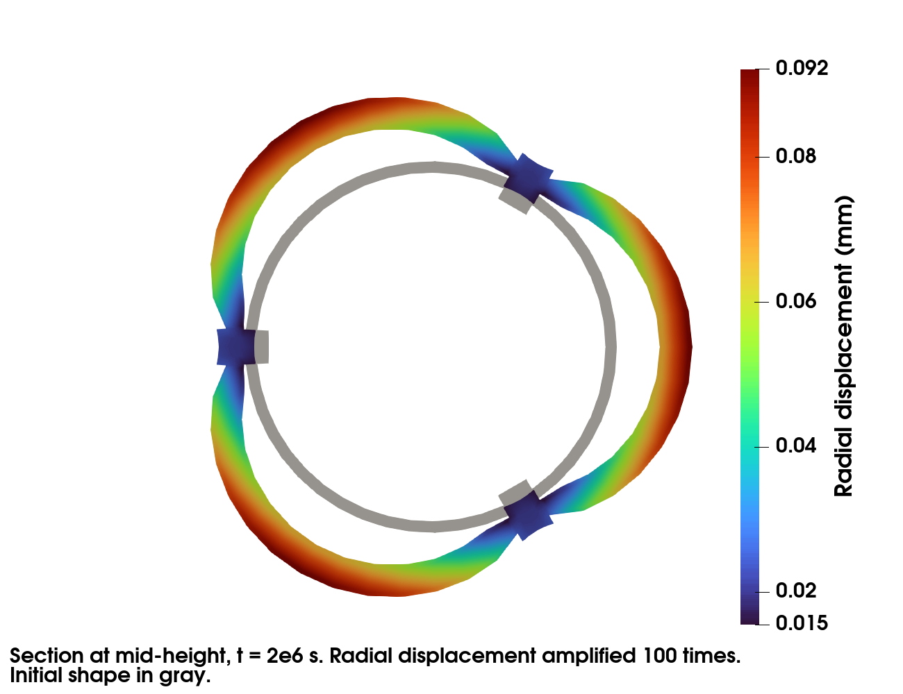

Thermomechanical Simulation of a RJH Plate
==========================================

.. contents::

website: https://github.com/latug0/mfem-mgis-examples/tree/master/ex8

This example models one ring of a RJH fuel assembly. The fuel is U3Si2. The
cladding and the stiffeners are ALFENI.

Two problems are strongly coupled at each time step by an
``IterativeCouplingScheme``:

- a heat transfer problem. The power density in the fuel increases linearly
  during a ramp, then stays constant.
- a mechanical problem at finite strain. It accounts for the thermal
  expansion, the swelling and the irradiation creep of the fuel, and for the
  plasticity of ALFENI.

The behaviours are written with MFront. The file ``MFront/README.md``
describes them.

Build the mesh
--------------

The default mesh ``mesh/assemblage_hexa.msh`` is generated by the gmsh script
``mesh/assemblage_hexa.py``. It is copied next to the executable when CMake
configures the build. The script requires the ``gmsh`` Python module:

.. code-block:: bash

   cd mesh
   python3 assemblage_hexa.py --output_file assemblage_hexa.msh

The coarser mesh ``mesh/assemblage_hexa_coarse.msh`` is generated with:

.. code-block:: bash

   python3 assemblage_hexa.py --densHaut 5 --densFuelLength 8 --densFuelThick 3 \
     --densCladConn 3 --densStifThick 3 --densStifConn 3 \
     --output_file assemblage_hexa_coarse.msh

+----------------------------+-------------------------------------+-----------------------+
| Option                     | Description                         | Default               |
+============================+=====================================+=======================+
| ``--densHaut``             | Number of elements along the height | 10                    |
+----------------------------+-------------------------------------+-----------------------+
| ``--densFuelLength``       | Number of elements along the fuel   | 15                    |
|                            | length                              |                       |
+----------------------------+-------------------------------------+-----------------------+
| ``--densFuelThick``        | Number of elements across the fuel  | 5                     |
|                            | thickness                           |                       |
+----------------------------+-------------------------------------+-----------------------+
| ``--densCladConn``         | Number of elements across the       | 5                     |
|                            | cladding thickness                  |                       |
+----------------------------+-------------------------------------+-----------------------+
| ``--densStifThick``        | Number of elements across the       | 5                     |
|                            | stiffener thickness                 |                       |
+----------------------------+-------------------------------------+-----------------------+
| ``--densStifConn``         | Number of elements in the stiffener | 5                     |
|                            | outside the cladding                |                       |
+----------------------------+-------------------------------------+-----------------------+
| ``--output_file``          | Output mesh file                    | assemblage_hexa.msh   |
+----------------------------+-------------------------------------+-----------------------+

Run the simulation
------------------

This command runs the default simulation on 2 processes:

.. code-block:: bash

   mpirun -n 2 ./rjh_plate

The results are exported to Paraview in the ``Results`` directory:

.. code-block:: bash

   paraview Results/Mechanics/Mechanics.pvd

The figures show the results at t = 2e6 s. They are computed with
``mpirun -n 4 ./rjh_plate -et 2e6 -ns 20``. The radial displacement is
amplified 100 times. The cladding bulges between the stiffeners.

.. figure:: img/ex8-3d.png
    :alt: Radial displacement at t = 2e6 s, amplified 100 times.

At the end of the simulation, the swelling is compared to its exact value. The
end of the power ramp is a time step boundary. The power density is thus
linear over each time step, and the swelling model integrates it exactly. The
run fails if they differ.

Available options
~~~~~~~~~~~~~~~~~

+------------------------------------+-----------------------------------+--------------------------+
| Command line                       | Description                       | Default                  |
+====================================+===================================+==========================+
| ``--mesh`` or ``-m``               | Mesh file                         | assemblage_hexa.msh      |
+------------------------------------+-----------------------------------+--------------------------+
| ``--libraryU3SI2`` or ``-lU``      | Material library of the U3Si2     | the library built with   |
|                                    | fuel                              | the example (U3SI2), for |
|                                    |                                   | the CPU or the GPU, as   |
|                                    |                                   | ``--execution`` places   |
|                                    |                                   | the behaviours           |
+------------------------------------+-----------------------------------+--------------------------+
| ``--libraryALFENI`` or ``-lA``     | Material library of the ALFENI    | the library built with   |
|                                    | cladding and stiffeners           | the example (ALFENI),    |
|                                    |                                   | for the CPU or the GPU,  |
|                                    |                                   | as ``--execution``       |
|                                    |                                   | places the behaviours    |
+------------------------------------+-----------------------------------+--------------------------+
| ``--linearsolver-thermal`` or      | Linear solver of the heat         | HypreGMRES               |
| ``-lsTh``                          | transfer problem                  |                          |
+------------------------------------+-----------------------------------+--------------------------+
| ``--preconditioner-thermal`` or    | Preconditioner of the linear      | HypreBoomerAMG           |
| ``-pcTh``                          | solver of the heat transfer       |                          |
|                                    | problem                           |                          |
+------------------------------------+-----------------------------------+--------------------------+
| ``--linearsolver-mechanics`` or    | Linear solver of the mechanical   | MUMPSSolver              |
| ``-lsMc``                          | problem                           |                          |
+------------------------------------+-----------------------------------+--------------------------+
| ``--preconditioner-mechanics`` or  | Preconditioner of the linear      | HypreBoomerAMG           |
| ``-pcMc``                          | solver of the mechanical problem  |                          |
+------------------------------------+-----------------------------------+--------------------------+
| ``--nonlinear-solver-mechanics``   | Non linear solver of the          | Newton                   |
| or ``-nlsMc``                      | mechanical problem: ``Newton``,   |                          |
|                                    | or ``NewtonK0`` (tangent systems  |                          |
|                                    | solved by GMRES preconditioned    |                          |
|                                    | by the elastic operator,          |                          |
|                                    | factorized by MUMPS at each       |                          |
|                                    | resolution of the mechanical      |                          |
|                                    | problem)                          |                          |
+------------------------------------+-----------------------------------+--------------------------+
| ``--ordering-mechanics`` or        | Ordering of the degrees of        | byNODES                  |
| ``-oMc``                           | freedom of the mechanical         |                          |
|                                    | problem: ``byNODES`` or           |                          |
|                                    | ``byVDIM``                        |                          |
+------------------------------------+-----------------------------------+--------------------------+
| ``--amg-strategy-mechanics`` or    | Strategy of the                   | the one of mfem-mgis     |
| ``-amgMc``                         | ``HypreBoomerAMG`` preconditioner |                          |
|                                    | of the mechanical problem:        |                          |
|                                    | ``System``, ``Elasticity``        |                          |
|                                    | (requires ``byVDIM``) or          |                          |
|                                    | ``None``. Ignored, with a         |                          |
|                                    | warning, without an iterative     |                          |
|                                    | solver preconditioned by          |                          |
|                                    | ``HypreBoomerAMG``.               |                          |
+------------------------------------+-----------------------------------+--------------------------+
| ``--matrix-symmetry-mechanics``    | Symmetry of the matrices of the   | ``Unsymmetric`` with     |
| or ``-msMc``                       | mechanical problem given to the   | ``Newton``,              |
|                                    | direct solver (tangent operator   | ``SymmetricIndefinite``  |
|                                    | with ``Newton``, elastic          | with ``NewtonK0``        |
|                                    | operator with ``NewtonK0``):      |                          |
|                                    | ``Unsymmetric``,                  |                          |
|                                    | ``SymmetricIndefinite`` or        |                          |
|                                    | ``SymmetricPositiveDefinite``.    |                          |
|                                    | Ignored, with a warning, without  |                          |
|                                    | a direct solver, unless           |                          |
|                                    | ``-nlsMc NewtonK0``.              |                          |
+------------------------------------+-----------------------------------+--------------------------+
| ``--reuse-analysis`` or ``-mra``,  | Reuse or not the analysis of the  | no reuse                 |
| ``--no-reuse-analysis`` or         | direct solvers (parameter         |                          |
| ``-no-mra``                        | ``ReuseAnalysis`` of              |                          |
|                                    | ``MUMPSSolver`` and               |                          |
|                                    | ``CuDSSSolver``) for the          |                          |
|                                    | matrices of the same pattern      |                          |
+------------------------------------+-----------------------------------+--------------------------+
| ``--order`` or ``-o``              | Finite element order              | 1                        |
+------------------------------------+-----------------------------------+--------------------------+
| ``--refinement`` or ``-r``         | Number of uniform refinements of  | 0                        |
|                                    | the mesh                          |                          |
+------------------------------------+-----------------------------------+--------------------------+
| ``--post-processing`` or ``-pp``,  | Export or not the results to      | export                   |
| ``--no-post-processing`` or        | Paraview                          |                          |
| ``-no-pp``                         |                                   |                          |
+------------------------------------+-----------------------------------+--------------------------+
| ``--verbosity-level`` or ``-v``    | Verbosity level of the linear     | 0                        |
|                                    | solvers                           |                          |
+------------------------------------+-----------------------------------+--------------------------+
| ``--debug`` or ``-d``,             | Print or not the minimum, maximum | print                    |
| ``--no-debug`` or ``-no-d``        | and mean values of the            |                          |
|                                    | temperature, of the norm of the   |                          |
|                                    | displacement, of the swelling and |                          |
|                                    | of the power density at the end   |                          |
|                                    | of the simulation                 |                          |
+------------------------------------+-----------------------------------+--------------------------+
| ``--reference-file`` or ``-rf``    | Reference values of these         | no comparison            |
|                                    | statistics, one line per field,   |                          |
|                                    | in the printed format             |                          |
+------------------------------------+-----------------------------------+--------------------------+
| ``--end-time`` or ``-et``          | End time of the simulation        | 1e5                      |
+------------------------------------+-----------------------------------+--------------------------+
| ``--nbsteps`` or ``-ns``           | Number of time steps              | 1                        |
+------------------------------------+-----------------------------------+--------------------------+
| ``--t-ramp`` or ``-tr``            | Duration of the power ramp. Its   | 1e5                      |
|                                    | end must be a time step boundary. |                          |
|                                    | 0 disables the ramp.              |                          |
+------------------------------------+-----------------------------------+--------------------------+
| ``--h-conv`` or ``-hc``            | Thermal convection coefficient    | 5e4                      |
+------------------------------------+-----------------------------------+--------------------------+
| ``--water-pressure`` or ``-wp``    | Coolant pressure on the cladding  | 1e6                      |
|                                    | and the stiffeners                |                          |
+------------------------------------+-----------------------------------+--------------------------+

The example also accepts the options of mfem-mgis, in particular
``--execution`` (``cpu``, ``gpu`` or ``mixed``), which places the computations
on the CPU or on the GPU (see :ref:`mfem_mgis_batch_computations_execution`).

The iterative solvers are ``CGSolver``, ``GMRESSolver``, ``BiCGSTABSolver``,
``MINRESSolver``, ``SLISolver``, ``HyprePCG``, ``HypreGMRES`` and
``HypreFGMRES``. The direct solvers are ``MUMPSSolver`` and ``CuDSSSolver``
(on a CUDA GPU, MFEM being built with cuDSS). They ignore the
preconditioner. The preconditioners are ``HypreBoomerAMG``,
``HypreDiagScale``, ``HypreEuclid``, ``HypreILU`` and ``HypreParaSails``.

Iterative solvers are much slower than MUMPS for the mechanics of this
problem. With the default mesh, the simulation takes 8 s on 2 processes with
MUMPS and 165 s on 4 processes with ``HyprePCG``.

Tests
-----

``ctest`` runs the following tests:

- ``rjh_plate`` runs the simulation on 2 processes. It compares the
  statistics of the temperature and of the displacement to the reference
  values. The full test mode uses the default mesh and
  ``assemblage_hexa-statistics.ref``. The restricted test mode uses the
  coarser mesh and ``assemblage_hexa_coarse-statistics.ref``.
- ``rjh_plate-kernels`` runs the same simulation with the integration of the
  behaviours by batches and the gradients, the inner forces and the tangent
  operator computed by kernels (environment variables of mfem-mgis), compared
  to the same reference.
- ``rjh_plate-mumps-spd`` does the same with the tangent operator of the
  mechanical problem given to MUMPS as a symmetric positive definite matrix
  (``-msMc SymmetricPositiveDefinite``).
- ``rjh_plate-newton-k0`` does the same with the mechanical problem solved by
  the ``NewtonK0`` method (``-nlsMc NewtonK0``).
- ``rjh_plate-gpu`` runs the first simulation on the GPU, MUMPS computing on
  the CPU (``--execution mixed --linear-solvers-execution cpu``), and
  ``rjh_plate-mixed-gpu`` the same with the finite elements computed on the
  CPU too (``--finite-elements-execution cpu``), with the option
  ``MFEM_MGIS_EXAMPLES_GPU_TESTS`` (see :doc:`index`).
- ``u3si2_swelling`` compares the swelling model to its exact value under a
  power ramp.
- ``robin_test`` compares the Robin boundary condition to the exact solution of
  a bar on 2 processes, and ``robin_test-gpu`` does the same with
  ``--execution gpu``, with the option ``MFEM_MGIS_EXAMPLES_GPU_TESTS``.

The simulations of the plate are only registered as tests if MFEM is built
with MUMPS.
