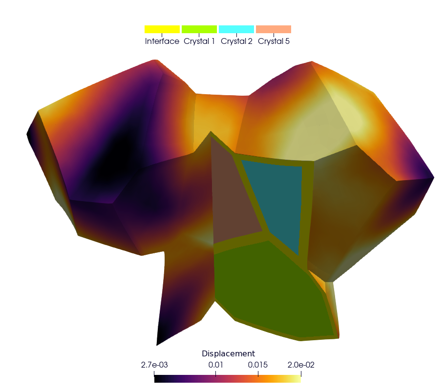

# mm-opera-hpc

This directory groups together the various test cases implemented as part of the OperaHPC project.

## Installation using Spack [recommended]

```bash
git clone --depth=2 --branch=v1.2.2 https://github.com/spack/spack.git
source spack/share/spack/setup-env.sh
spack repo update builtin --branch develop
```

The last command selects the `develop` branch of the Spack packages, because their releases do not provide mfem-mgis yet.

The test cases of this branch require the prototype branch of mfem-mgis, which provides the CMake function `mfem_mgis_add_behaviours_library`, the option `--execution` and the function `mfem_mgis::getBehavioursLibrary` used by the three cases. This branch of mfem-mgis must be built from its sources, as described by its installation guide, with a version of MGIS providing `MGIS/FieldOperations.hxx`. `spack install mfem-mgis@master` installs a version of mfem-mgis without these functions, with which the configuration of the test cases fails; Spack may still provide the other dependencies (MFEM, TFEL...).

The test cases build their behaviour libraries with MFront: when CMake configures the build, `mfront` must be found in the `PATH` (or given by the CMake variable `MFRONT`).

Build and run the test cases from the sources of this branch, `MFEMMGIS_DIR` giving the installation of mfem-mgis:

```bash
cmake -S mm-opera-hpc -B build -DMFEMMGIS_DIR=<prefix of mfem-mgis>/share/mfem-mgis/cmake
cmake --build build -j 4
ctest --test-dir build
```

The option `-DMM_OPERA_HPC_GPU_TESTS=ON` also registers the tests of the cases on a GPU (`--execution gpu`, and `--execution mixed --behaviours cpu` for the polycrystal), when MFEM is compiled with CUDA or HIP and the behaviour libraries of the case are built for the GPU (TFEL providing the configuration file `config-cuda-nvcc.json`, resp. `config-hip-hipcc.json`, of MFront; CMake prints why they are not built). A GPU is then required to run them. The three cases accept the options of mfem-mgis, in particular `--execution cpu|gpu|mixed`, which places the computations on the CPU or on the GPU.

For more details on installing mfem-mgis, for example on a supercomputer without internet access, see its installation guide: https://thelfer.github.io/mfem-mgis/installation_guide/installation_guide.html

## Over-pressurized bubbles scenario 

Directory: `bubble`.


### Physical Problem

The applicative study case is the elastic computation of the stress field induced by an internal pressure prescribed in spherical porosities (e.g., a fission gas bubble for fuel) distributed randomly in a periodic RVE. The boundary conditions are null macroscopic displacement gradient corresponding to a macroscopic strain equal to zero. The periodic surface of the RVE is defined according a Voronoi tessellation principle in order to avoid truncated porosities and ensure a high quality of the periodic solution near the boundary. In the general case the null periodic displacement boundary condition prevents the volume expansion with a non-zero macroscopic hydrostatic stress. The latter can be derived from the periodic elastic stress field with equation: 

$$
p_{hyd} = -\dfrac{1}{3} tr\left(\dfrac{1}{V}\int_V \overline{\overline{\sigma}} dV\right)
$$

 where $V$ is the volume of the RVE and $\overline{\overline{\sigma}}$ the Cauchy stress field. The corresponding internal stress field induced by an internal pressure equal to ($p_{in}-p_{hyd}$) in porosities and a stress-free periodic boundary condition can be derived from the elastic superposition principle given by the equation 

$$
\overline{\overline{σ}}\left(p_{in}-p_{hyd}, 0\right) = \overline{\overline{σ}}\left(p_{in},p_{hyd}\right)+ p_{hyd} \overline{\overline{I}}  
$$
 
Where $\overline{\overline{I}}$ is the identity tensor.

### Link to transient fission gas release

Fission gas stored in high burnup structure (HBS) porosities into nuclear fuel can be released due to an overfragmentation mechanism under certain conditions: we can use the present model to investigate this phenomenon. The fracture assessment is done based on a purely elastic calculation: from the stress tensor we calculate the principal stresses, and we assess all the physical points where the following relationship is satisfied:

$$
\sigma_I^{max}\mid_i (p_{in}) > \sigma_R
$$

where $σ_I^{max}\mid_i (p_{in})$ is the maximal value of the first principal stress near the bubble $i$ submitted to the pressure $p_{in}$ and $σ_R$ the rupture stress giving the critical pressure leading to crack initiation. For a bubble $i$, the maximal value of the first principal stress $\sigma_I^{max}\mid_i$ corresponds to the maximal value at a distance $R+\delta$ from the centre of the bubble, with R the radius of the bubble and $δ$ the distance needed to reach the first Gauss integration point around the bubble in the finite element mesh.

The fractional fission gas release for bubbles having all the same internal pressure $p_{in}$ can be calculated as follows

$$
FGR=\dfrac{∑_i\left[V_i \mid\left(σ_I^{max} \mid_i \left(p_{in}\right)\right)>σ_R \right]}{∑_{i=1}^n V_i}
$$

under the assumption that, just after crack initiation, its propagation occurs under an unstable condition, effectively enabling the release of all the amount of gas contained in the bubble outside from the HBS volume element.

More details in [bubble/README.md](./bubble/README.md)

## Polycrystal Case

This test case illustrates the simulation of a Representative Volume Element (RVE) of a polycrystal made of uranium dioxide (`UO₂`). The objective is to study the mechanical viscoplastic response of the material under a macroscopic uniaxial loading. The example given in the repository of this test case corresponds to a simplification with a polycrystal composed of 5 crystals in order to enable an easy comparison with a reference solution given by the Cast3M code. 


More details in [polycrystal/README.md](./polycrystal/README.md)

## Cermet Case

This example illustrates the simulation of a UO₂ polycrystalline microstructure with metallic interfaces at the grain boundaries (CERMET). The objective is to study the mechanical viscoplastic response of the material, including the strain localization in the metallic interface, under a macroscopic uniaxial loading. The example given in the repository of this test case corresponds to a simplification with only 5 grains in order to enable an easy comparison with a reference solution given by the Cast3M code.



More details in [cermet/README.md](./cermet/README.md)
