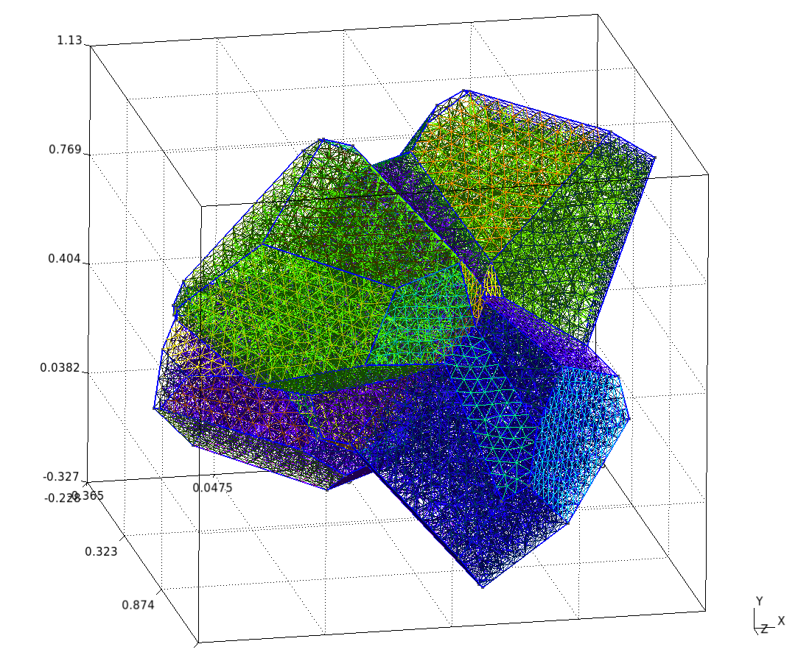
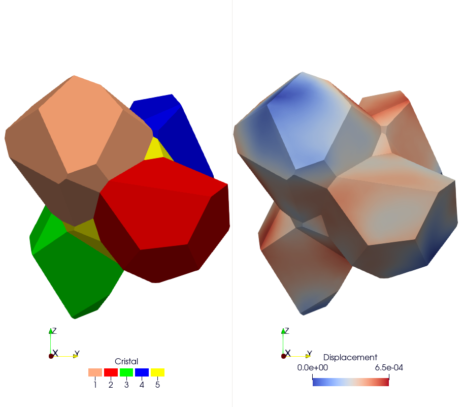
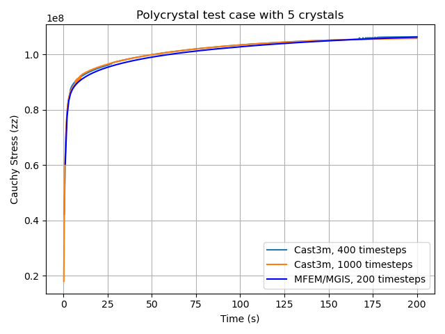

# Polycrystal

## Problem definition

This test case illustrates the simulation of a Representative Volume Element (RVE) of a polycrystal made of uranium dioxide (UO₂). The objective is to study the mechanical response of the material under a uniaxial loading (see the description of the boundary conditions below). In addition to the mechanical analysis, this example implements a fixed-point algorithm enabling the simulation of a uniaxial compression/tensile test with periodic boundary conditions.	

- **Boundary conditions:** periodic boundary conditions are applied on the RVE faces. The loading is imposed in one direction, ensuring compatibility and equilibrium across periodic faces. More precisely, the axial component Fzz of the macroscopic deformation gradient is imposed. The off-diagonal components of the macroscopic deformation gradient are set to zero. The components Fxx and Fyy are the unknowns; they are determined via the fixed-point algorithm imposing zero values for the components Sxx and Syy of the macroscopic Cauchy stress tensor. The main result used for verification is the evolution of the axial component Szz of the Cauchy stress as a function of time, which is a stress-strain curve as Fzz increases linearly with time.
- **Finite element order:** 1 (linear interpolation).
- **Finite element space:** H1.
- **Simulation duration:** 200 s.
- **Number of time steps:** 200.
- **[Crystal] Constitutive law:** The UO₂ crystal plasticity law used in the example is detailed in reference [^2]; the corresponding MFront file is `law/Mono_UO2_CosH_Jaco3.mfront`. In the case of uranium dioxide, the crystal symmetry is cubic and the corresponding orthotropic elastic properties used in the crystal plasticity law are:
	- Young's modulus = 222.e9 Pa
	- Poisson's ratio = 0.27
	- Shear modulus = 54.e9 Pa

The orthotropic basis of each grain is given as an input of the crystal plasticity law. This orthotropic basis is precomputed with the Euler angles of the grain. The fixed-point algorithm uses the homogenized elastic properties of the polycrystal in order to predict the displacement gradient needed to converge toward a uniaxial tensile test. These macroscopic properties are derived from the single-crystal elastic constants given above with the Kröner self-consistent estimate for an isotropic polycrystal (see `src/MacroscopicElasticMaterialProperties.cxx` in the repository; it is close to the mean of the Voigt and Reuss bounds).

The macroscopic stresses `Sxx` and `Syy` are driven to zero, while the macroscopic shear components of the deformation gradient are kept null: the macroscopic shear stresses are reactions, about 2 % of `Szz` in the elastic regime for the 5 grains of the default mesh (the reference computation of Cast3M imposes the same conditions). The loading is thus uniaxial for the normal stresses only.

## Mesh generation

This section explains how to generate a sample mesh with the Mérope toolkit [^1].

Before running the script, make sure that the environment variable
`MEROPE_DIR` is properly set.

Then, you can generate the mesh in two steps:

```
source ${MEROPE_DIR}/Env_Merope.sh
python3 mesh/5crystals.py # generate 5crystals.geo
gmsh -3 5crystals.geo # generate 5crystals.msh
```

You will obtain a 3D mesh (5crystals.msh) of a polycrystalline sample
with 5 grains.

### Mesh generation options

The following parameters are set in the `5crystals.py` script:

```
L = [1, 1, 1]        # Dimensions of the RVE box
nbSpheres = 5        # Number of grains (polycrystal composed of 5 crystals)
distMin = 0.4        # Minimum distance between sphere centers
randomSeed = 0       # Random seed for reproducibility
MeshOrder = 1        # Polynomial order of elements
MeshSize = 0.05      # Target mesh size
```

The resulting polycrystal is composed of 5 grains.

### Mesh of the polycrystal composed of 5 crystals




## Simulation options


The main executable for this test case is uniaxial-polycrystal. Its
command-line options are:

```
Usage: ./uniaxial-polycrystal --help 
```

| Option                                      | Type   | Default                      | Description                                                                                                                                   |
| ------------------------------------------- | ------ | ---------------------------- | --------------------------------------------------------------------------------------------------------------------------------------------- |
| `-h, --help`                                | flag   | off                          | Print the help message and exit.                                                                                                              |
| `-m <string>, --mesh <string>`              | string | `mesh/5crystals.msh`         | Mesh file to use.                                                                                                                             |
| `-mm <string>, --mesh_mode <string>`        | string | `FromScratch`                | Mesh read mode (`FromScratch`, or `Restart` for a split mesh).                                                                                |
| `-f <string>, --vect <string>`              | string | `mesh/vectors_5crystals.txt` | Vector file to use.                                                                                                                           |
| `-l <string>, --library <string>`           | string | built with the case | Material library (by default, the library built with the case for the CPU or for the GPU, as `--execution` places the behaviours).                                                                                                                             |
| `-b <string>, --behaviour <string>`         | string | `Mono_UO2_Cosh_Jaco3`        | Mechanical behaviour.                                                                                                                         |
| `-o <int>, --order <int>`                   | int    | `1`                          | Finite element order (polynomial degree).                                                                                                     |
| `-r <int>, --refinement <int>`              | int    | `0`                          | Refinement level of the mesh (default = 0).                                                                                                   |
| `-v <int>, --verbosity-level <int>`         | int    | `0`                          | Verbosity level of the output.                                                                                                                |
| `-d <double>, --duration <double>`          | double | `200`                        | Duration of the simulation.                                                                                                                   |
| `-n <int>, --nstep <int>`                   | int    | `200`                        | Number of simulation steps.                                                                                                                   |
| `-dg, --displacement-gradient`, `-no-dg, --no-displacement-gradient` | bool | `false` | Give the displacement gradient H = F - I instead of the deformation gradient to the behaviour (parameter `DisplacementGradient` of mfem-mgis). In single precision, the macroscopic loading, kept as a displacement gradient, keeps its precision. The behaviour, written with the deformation gradient, receives F = I + H. |
| `--linear-solver <string>`                  | string | `HyprePCG`                   | Linear solver of the Newton method: a Krylov solver of hypre (`HyprePCG`, `HypreGMRES` or `HypreFGMRES`, preconditioned by `--linear-solver-preconditioner`), or a direct solver of mfem-mgis, `MUMPSSolver` or `CuDSSSolver` (on a CUDA GPU only), the matrices being given as general ones. Ignored by `NewtonK0`. |
| `--reuse-analysis`, `--no-reuse-analysis`   | bool   | `false`                      | Reuse the analysis of the direct solver for the matrices of the same pattern (parameter `ReuseAnalysis` of mfem-mgis). Ignored, with a warning, without a direct solver, with `NewtonK0` or with PETSc. |
| `--non-linear-solver <string>`              | string | `Newton`                     | Non linear solver: `Newton` or `NewtonK0` (tangent systems solved by a conjugate gradient preconditioned by the elastic operator).            |
| `--non-linear-solver-maximum-iterations <int>` | int  | `20`                         | Maximum number of iterations of the non linear solver for each resolution of the microscopic equilibrium. A resolution which does not converge within this number of iterations fails, and the time step is divided by two (ten times at most per temporal sequence). |
| `--line-search <string>`                    | string | `None`                       | Line search of the non linear solver (`Newton` or `NewtonK0`): `None`, or `Backtracking` (option `LineSearch` of mfem-mgis). With `Backtracking`, the step of an iteration is halved, ten times at most, until the norm of the residual decreases; an estimate at which the integration of the behaviour fails is refused; a resolution fails, and the time step is divided by two, if no step is acceptable. Recommended with `--adaptive-linear-solver-tolerance EisenstatWalker1`. |
| `--prediction <string>`                     | string | `Default`                    | Prediction of the unknowns at the first resolution of each time step: `Default` (the unknowns at the beginning of the time step), or `LinearExtrapolation` (strategy `LINEAR_EXTRAPOLATION_PREDICTION` of mfem-mgis): the increment of the unknowns of the previous time step is extrapolated, weighted by the ratio of the time increments, as the macroscopic displacement gradient already is. The following resolutions of the time step (fixed point on the lateral stresses) start from the previous one. The reference of the relative criterion remains the residual of the default prediction, computed by one integration of the behaviour without tangent operator per time step: the ratio `\|\|r\|\|/\|\|r_0\|\|` written at the iteration 0 is lower than one when the extrapolation is better than the default prediction. Not supported with PETSc. |
| `--adaptive-linear-solver-tolerance <string>` | string | `None`                       | Relative tolerance of the linear solver adapted to the decrease of the residual: `None`, `EisenstatWalker1` or `EisenstatWalker2`; requires an iterative linear solver. |
| `--adaptive-linear-solver-initial-tolerance <double>` | double | `-1`                         | Initial adaptive tolerance, the default one if `-1`. Giving it without `--adaptive-linear-solver-tolerance` is an error.                      |
| `--adaptive-linear-solver-maximum-tolerance <double>` | double | `-1` | Maximum adaptive tolerance, the default one (0.9) if `-1`: the tolerance of Eisenstat and Walker rises to it when the residual increases, for instance after a failure of the integration of the behaviour. Giving it without `--adaptive-linear-solver-tolerance` is an error. |
| `--elastic-operator-linear-solver <string>` | string | `HypreBoomerAMG`             | Linear solver of the elastic operator of `NewtonK0`: `HypreBoomerAMG` or `AmgX` (one cycle of the multigrid of AmgX, which requires mfem-mgis built with `-Denable-amgx=ON`). |
| `--hypre-boomeramg-parameters <string>`     | string |                              | Options of the BoomerAMG preconditioner of hypre of the elastic operator of `NewtonK0`, as `name=value` separated by commas, with the names of mfem-mgis (`setHypreBoomerAMGPreconditioner`): for instance `MaximumCoarseSize=2000,AggressiveCoarseningLevels=1`. A real value is written with a decimal point (`StrongThreshold=0.5`). Without this option, the preconditioner has the default configuration of mfem-mgis. Requires `--elastic-operator-linear-solver HypreBoomerAMG`. |
| `--amgx-parameters <string>`                | string |                              | Parameters of AmgX, as `name=value` separated by commas. Requires `--elastic-operator-linear-solver AmgX`. |
| `--amgx-single-precision`, `--no-amgx-single-precision` | bool   | `false`                      | Computations of AmgX in single precision. Requires `--elastic-operator-linear-solver AmgX`. |
| `--linear-solver-preconditioner <string>`   | string | `HypreBoomerAMG`             | Preconditioner for the linear solver. Use `none` to disable.                                                                                  |
| `--macroscopic-stress-output-file <string>` | string | `uniaxial-polycrystal.res`   | Output file containing the evolution of the diagonal components of the deformation gradient and the diagonal components of the Cauchy stress. |
| `--macroscopic-secant-acceleration`         | bool   | `false`                      | Update the lateral compliance of the fixed point on `Sxx` and `Syy` by Broyden's secant method instead of using the elastic one at each iteration (fewer resolutions of the mechanical problem once plasticity develops). |
| `--no-macroscopic-secant-acceleration`      | bool   | —                            | Use the elastic lateral compliance at each iteration (default). |
| `--enable-post-processing`                  | bool   | `true`                       | Execute post-processing steps (default).                                                                                                      |
| `--disable-post-processing`                 | bool   | —                            | Do not execute post-processing steps.                                                                                                         |
| `--enable-paraview-export`                  | bool   | `true`                       | With the post-processing steps, export the displacement to ParaView at each step (default), in the collection `OutputFile-Uniaxial-polycrystal`, or in the collection `PolycrystalParaviewResults` with the stresses if they are exported (see below); the averages of the stresses per grain (file `avgStressPolycrystal`) are always computed. |
| `--disable-paraview-export`                 | bool   | —                            | Do not export the displacement to ParaView. |
| `--single-material`                         | bool   | `false`                      | One material for all the grains, whose orientations are given point by point, instead of one material per grain: the behaviour is integrated by one batch over all the grains (on a GPU, one kernel per phase instead of one per grain). The averages of the stresses per grain are written in the same file `avgStressPolycrystal`. |
| `--material-per-grain`                      | bool   | —                            | One material per grain (default). |
| `--enable-export-von-Mises-stress`          | bool   | `false`                      | Export the von Mises stress to ParaView at each step (L2 projection at the nodes). With the displacement (`--enable-paraview-export`), both are written in the same files, the mesh being written once per step, in the collection `PolycrystalParaviewResults`; otherwise, the stresses are written in the collection `PolycrystalParaviewOutput`. In all the collections, the cycle k is the end of the step k + 1. |
| `--disable-export-von-Mises-stress`         | bool   | —                            | Do not export the von Mises stress (default).                                                                                                 |
| `--enable-export-first_eigen_stress`        | bool   | `false`                      | Export the first principal stress, in the same collection as the von Mises stress. |
| `--disable-export-first_eigen_stress`       | bool   | —                            | Do not export the first principal stress (default).                                                                                           |
| `--enable-paraview-single-precision`        | bool   | `false`                      | Write the ParaView files (displacement, von Mises stress, first eigen stress) in single precision (`Float32`) instead of double precision (`Float64`): the coordinates of the nodes and the fields are rounded to the nearest single precision value, and the files take about half the room. |
| `--disable-paraview-single-precision`       | bool   | —                            | Write the ParaView files in double precision (default). |

The options of `mfem-mgis` are also accepted, for instance `--execution gpu`
to compute on a GPU, the behaviours built by the case for the GPU being then
used (or `--execution mixed` to place each phase on the CPU or on the GPU).

Note: To generate the grain orientation vectors, use the randomVectorGeneration tool provided in the distribution. This ensures a consistent and physically realistic initialization of crystallographic orientations.



## Run the simulation

You can run the simulation in parallel using MPI:

```
mpirun -n 16 ./uniaxial-polycrystal
```

By default, the simulation generates the file `uniaxial-polycrystal.res`.

## Results and post-processing

### Plot and Compare

To visualize and compare the results, run the following Python script:

```
python3 plot_polycrystal_results.py
```

This script generates a figure named `plot_polycrystal.png`, shown below. In this figure we can observe that there is a good agreement between Cast3M and MFEM-MGIS results. Although Cast3M is our reference, the stress-strain curve shows an unexpected non-smooth evolution. These oscillations are associated with the time step discretization which was specified in the MFEM-MGIS simulation. For a larger number of time steps the Cast3M curve is smoother, like the MMM results shown below. A first analysis of this issue led us to conclude that the implicit formulation of the Cast3M code, based on a quasi-Newton algorithm using the elastic stiffness and line search type convergence acceleration, is not fully stable. The main conclusion of this work is that the implicit formulation of MFEM-MGIS (full Newton algorithm using the tangent stiffness) is very efficient, thanks to the quadratic convergence and parallelization, and provides a high-quality solution. For the verification process, the number of time steps has been significantly increased in order to avoid as much as possible the oscillations of the Cast3M solution.      



### Check the Values

To verify the simulation results, run the following Python script:

```
python3 check_polycrystal_results.py
```

The expected output is: `Check PASS`.

An example of the detailed output:

```
      Time     MFEM/MGIS       CAST3M  RelDiff_% Status
0      1.0  6.041066e+07   63121000.0   4.486524     OK
1      2.0  7.737121e+07   78996000.0   2.099997     OK
2      3.0  8.327457e+07   84282000.0   1.209769     OK
3      4.0  8.583679e+07   86623000.0   0.915934     OK
4      5.0  8.730071e+07   87898000.0   0.684177     OK
..     ...           ...          ...        ...    ...
195  196.0  1.061861e+08  105790000.0  -0.373003     OK
196  197.0  1.062065e+08  105800000.0  -0.382700     OK
197  198.0  1.062266e+08  105800000.0  -0.401578     OK
198  199.0  1.062465e+08  105810000.0  -0.410809     OK
199  200.0  1.062661e+08  105820000.0  -0.419810     OK

[200 rows x 5 columns]
Check PASS.
```

This table shows the comparison between the simulated Cauchy stress values and the reference Cast3M results, along with the relative difference and a status check.

## Tests

`ctest` runs `UniaxialPolycrystalTest` (one time step of 0.2 s without post-processing, whose axial stress `Szz` is compared to the one computed by Cast3M, `results/polycrystal_cast3m.csv`, with a relative tolerance of 1 %, by `cmake/run-and-check.py`, which requires Python 3; without it, the case is only run), `UniaxialPolycrystalTest-DisplacementGradient` (the same with `--displacement-gradient`), `UniaxialPolycrystalTestPar` (the same on 2 processes), `UniaxialPolycrystalTest-MaximumIterations` (the first test with `--non-linear-solver NewtonK0 --adaptive-linear-solver-tolerance EisenstatWalker1 --non-linear-solver-maximum-iterations 1`: a resolution of this time step takes four iterations, so the first one fails; the test expects the division of the time step, and no second iteration), `UniaxialPolycrystalTest-LineSearch` (the first test with `--non-linear-solver NewtonK0 --adaptive-linear-solver-tolerance EisenstatWalker1 --line-search Backtracking`), `UniaxialPolycrystalTest-LineSearch-Invalid` (an unknown line search is refused), `UniaxialPolycrystalTest-LinearExtrapolation` (the same time of 0.2 s in four time steps, with `--non-linear-solver NewtonK0 --adaptive-linear-solver-tolerance EisenstatWalker1 --line-search Backtracking --prediction LinearExtrapolation`: same axial stress, and a ratio `||r||/||r_0||` lower than one at the iteration 0 of a resolution, which only happens with the extrapolation), `UniaxialPolycrystalTest-Prediction-Invalid` (an unknown prediction is refused) and `PolycrystalTestWithPostProPar` (one time step of 0.01 s on 2 processes, exporting the von Mises stress and the first eigen stress). With the option `MM_OPERA_HPC_GPU_TESTS` (see the main README), `UniaxialPolycrystalTest-gpu` and `UniaxialPolycrystalTest-mixed-gpu` run the first test with `--execution gpu` and with `--execution mixed --behaviours-execution cpu`.

With the option `--single-material`, `UniaxialPolycrystalTest-SingleMaterial` compares the same axial stress to the one of Cast3M. `UniaxialPolycrystalTest-SingleMaterial-Comparison` and `UniaxialPolycrystalTestPar-SingleMaterial-Comparison` (on 2 processes) run two time steps of 0.2 s with and without the option, each run in its own directory, and compare the main output files and the averages of the stresses per grain (`avgStressPolycrystal`) of the two runs (`cmake/run-and-compare.py`): relative tolerances of 1e-9 on the main output file and of 2e-5 on the averages, written with 6 digits (1 % in single precision).

## References

[^1]: JOSIEN, Marc. Mérope: A microstructure generator for simulation of heterogeneous materials. Journal of Computational Science, 2024, vol. 81, p. 102359.
[^2]: PORTELETTE, Luc, AMODEO, Jonathan, MADEC, Ronan, et al. Crystal viscoplastic modeling of UO2 single crystal. Journal of Nuclear Materials, 2018, vol. 510, p. 635-643.
