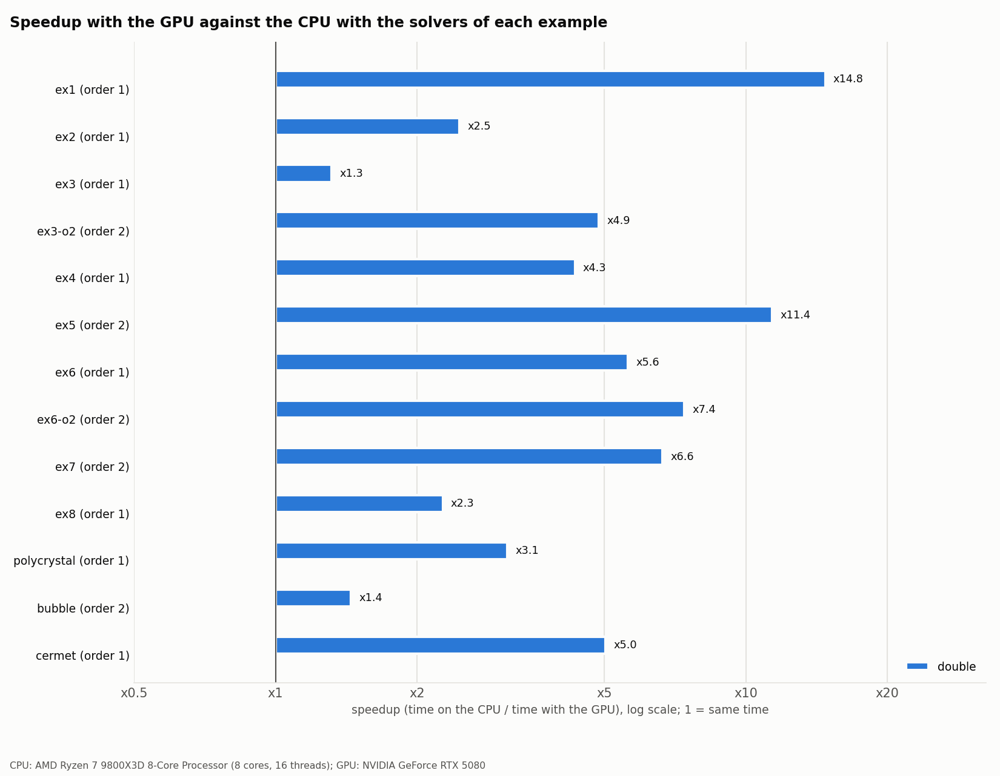
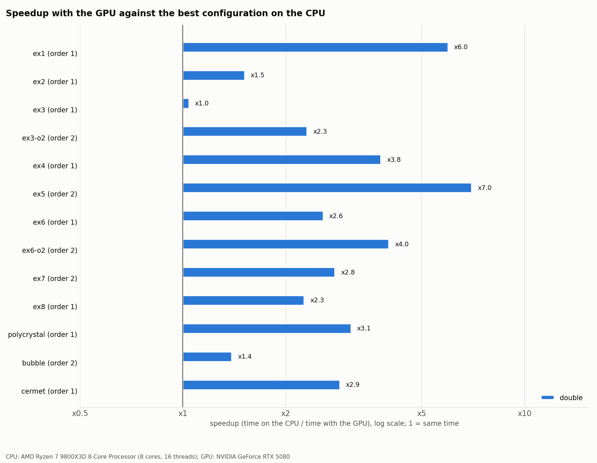

# Graphs of the benchmark of the examples

CPU: AMD Ryzen 7 9800X3D 8-Core Processor (8 cores, 16 threads); GPU: NVIDIA GeForce RTX 5080. Generated by `cases/benchmark_plots.py` from the runs of `cases/benchmark_slides.py` (see `docs/benchmark-slides.md`). Wall time of the whole program; the CPU runs use 8 or 16 MPI processes, the GPU runs one process. The reference is the CPU with the solvers of each example (as shipped); the best CPU configuration is shown too.

The graphs at the screening size are preliminary (one run of each configuration, fewer steps): they are replaced by the graphs at the measurement size once the final runs of the case are made.

| graph | case | size | unknowns | precision | GPU | speedup vs solvers of the example | speedup vs best CPU |
|---|---|---|---|---|---|---|---|
| [ex5-bench-o2-double.png](ex5-bench-o2-double.png) **(highlight)** | ex5 | measurement | 1847042 | double | GPU: Krylov of hypre + BoomerAMG | x11.4 | x7.0 |
| [ex1-bench-o1-double.png](ex1-bench-o1-double.png) **(highlight)** | ex1 | measurement | 823875 | double | GPU: Krylov of hypre + BoomerAMG | x14.8 | x6.0 |
| [ex6-o2-bench-o2-double.png](ex6-o2-bench-o2-double.png) **(highlight)** | ex6-o2 | measurement | 786432 | double | GPU: Newton-K0, K0 by one cycle of BoomerAMG, tangent operator without assembly | x7.4 | x4.0 |
| [ex4-bench-o1-double.png](ex4-bench-o1-double.png) **(highlight)** | ex4 | measurement | 196047 | double | GPU: Krylov of Belos + MueLu (Chebyshev smoother) | x4.3 | x3.8 |
| [polycrystal-bench-o1-double.png](polycrystal-bench-o1-double.png) **(highlight)** | polycrystal | measurement | 168885 | double | GPU: solvers of the example (PCG of hypre + BoomerAMG) | x3.1 | x3.1 |
| [cermet-bench-o1-double.png](cermet-bench-o1-double.png) **(highlight)** | cermet | measurement | 269253 | double | GPU: Newton-K0, K0 by one cycle of BoomerAMG, tangent operator without assembly | x5.0 | x2.9 |
| [ex7-bench-o2-double.png](ex7-bench-o2-double.png) **(highlight)** | ex7 | measurement | 167976 | double | GPU: Newton-K0, K0 by one cycle of BoomerAMG, tangent operator without assembly | x6.6 | x2.8 |
| [ex6-bench-o1-double.png](ex6-bench-o1-double.png) **(highlight)** | ex6 | measurement | 786432 | double | GPU: Newton-K0, K0 by one cycle of BoomerAMG | x5.6 | x2.6 |
| [ex3-o2-bench-o2-double.png](ex3-o2-bench-o2-double.png) **(highlight)** | ex3-o2 | measurement | 786432 | double | GPU: solvers of the example (CG of MFEM without preconditioner) | x4.9 | x2.3 |
| [ex8-bench-o1-double.png](ex8-bench-o1-double.png) **(highlight)** | ex8 | measurement | 214812 | double | GPU: mechanics: cuDSS (direct) | x2.3 | x2.3 |
| [ex2-bench-o1-double.png](ex2-bench-o1-double.png) **(highlight)** | ex2 | measurement | 908226 | double | GPU: Krylov of hypre + BoomerAMG, inexact Newton (Eisenstat-Walker) | x2.5 | x1.5 |
| [bubble-bench-o2-double.png](bubble-bench-o2-double.png) | bubble | measurement | 467109 | double | GPU: Krylov of hypre + BoomerAMG | x1.4 | x1.4 |
| [ex3-bench-o1-double.png](ex3-bench-o1-double.png) | ex3 | measurement | 786432 | double | GPU: solvers of the example (CG of MFEM without preconditioner) | x1.3 | x1.0 |
